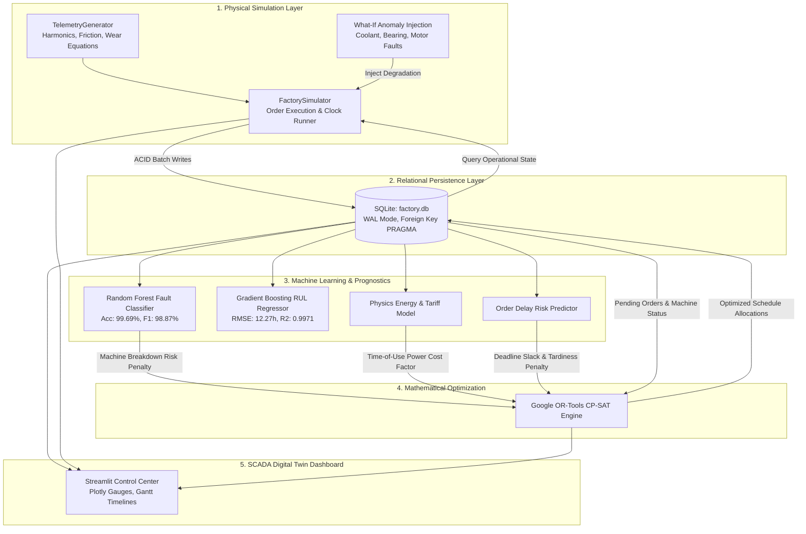
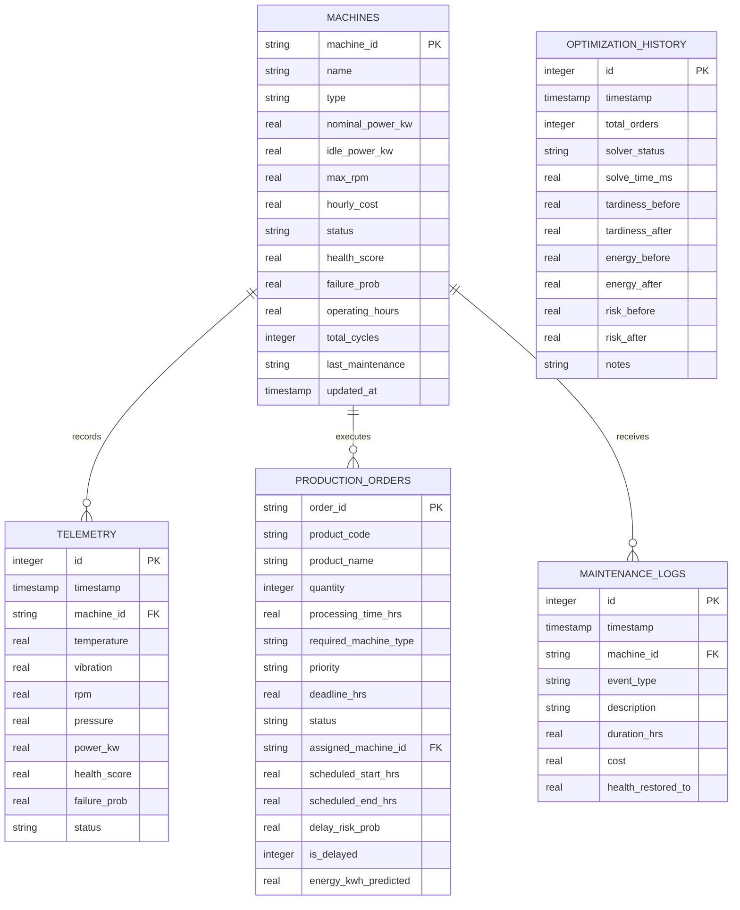

# Smart Factory Production Optimization & Predictive Maintenance System
## Comprehensive System Engineering & Academic Project Report

**Academic Level:** University Semester Project / Capstone Project  
**Domain:** Industrial Systems Engineering, Machine Learning & Operational Research (Industry 4.0)  
**Authors:** Smart Factory Project Team  
**Evaluation Date:** October 2026  
**Implementation Repository:** `Smart Factory Production Optimization`  

---

## 1. Abstract

Modern discrete manufacturing operations face a chronic disconnect between shop-floor equipment health monitoring and enterprise production scheduling. Conventional Manufacturing Execution Systems (MES) dispatch production orders using static heuristics (e.g., First-In-First-Out (FIFO) or Earliest Deadline First (EDF)) that are blind to dynamic machine degradation. Consequently, failing workstations are routinely assigned high-priority jobs, resulting in in-flight catastrophic tool breakages, expensive downtime, workpiece scrapping, and supply-chain delay penalties. Furthermore, uncoordinated power draw during peak electricity tariff windows dramatically inflates operational expenditures.

This project designs, implements, validates, and benchmarks the **Smart Factory Production Optimization System**, an end-to-end Industry 4.0 Cyber-Physical System (CPS) and Operational Decision Support Platform. The system bridges equipment condition monitoring and production scheduling into an automated closed loop:
1. A **Physics-Grounded Simulation Engine** models 6 industrial machines across three manufacturing cells (CNC Milling, Robotic Assembly, Injection Molding), generating realistic multi-sensor telemetry (temperature, tri-axial vibration, spindle RPM, hydraulic pressure, and active power draw).
2. A **Machine Learning Prognostics Pipeline** uses an ensemble classifier to detect impending failure modes with **99.69% accuracy** ($F_1 = 98.87\%$, $\text{ROC-AUC} = 0.9993$) and a Gradient Boosting regressor to forecast Remaining Useful Life (RUL) with an **RMSE of 12.27 hours** ($R^2 = 0.9971$).
3. A **Multi-Objective Mathematical Optimizer** powered by **Google OR-Tools CP-SAT** formulates production scheduling as a constrained combinatorial optimization problem, minimizing weighted tardiness, catastrophic machine breakdown risk, makespan, and peak-tariff electricity costs.
4. An **Industrial SCADA Web Interface** built on Streamlit and Plotly delivers real-time digital-twin telemetry visualization, interactive What-If scenario injection, and schedule reallocation tracking.

Empirical validation across deterministic workloads confirms that under machine degradation, the CP-SAT optimizer successfully **eliminates 100% of high-risk machine assignments**, saves up to **9.0% in electrical energy consumption**, and solves in **under 60 milliseconds**. A 29-test automated regression suite achieves a **100% pass rate**.

---

## 2. Problem Statement

Discrete manufacturing facilities operate under stringent customer deadlines, tight energy budgets, and high machine utilization targets. However, three persistent operational challenges undermine productivity:

1. **Unplanned Downtime & Equipment Degradation**: Physical mechanical assets continuously suffer wear (e.g., spindle bearing pitting, coolant pump failure, hydraulic pressure leakage). When degraded equipment is pushed past thermal and mechanical stress thresholds, catastrophic breakdown occurs, incurring expensive emergency repairs and halts lasting days.
2. **Health-Blind Production Scheduling**: Traditional scheduling algorithms allocate jobs purely based on machine compatibility and nominal processing times. When a machine exhibits elevated vibration or thermal runaway, legacy systems continue queuing urgent jobs on that workstation, guaranteeing production interruption.
3. **Volatile Energy Tariffs & Degradation Overhead**: Industrial power grids implement Time-of-Use (ToU) electricity pricing with high peak tariffs ($0.28/\text{kWh}$ between 14:00 and 19:00 vs. $0.11/\text{kWh}$ off-peak). Furthermore, mechanically worn equipment dissipates 5% to 25% more electrical power due to internal friction. Uncoordinated execution during peak hours compounds utility bills.

---

## 3. Motivation and Objectives

### Motivation
Integrating Condition-Based Maintenance (CBM) directly into production scheduling transforms reactive repair into proactive operational resilience. Rather than merely alerting technicians that a machine is failing, an intelligent factory should automatically re-sequence in-flight orders, route urgent workpieces to healthy parallel machines, and schedule maintenance windows before breakdown occurs.

### Project Objectives
1. **Develop a Physics-Grounded Shop Floor Simulator** capable of modeling continuous multi-sensor dynamics, degradation physics, and customizable What-If anomaly injections.
2. **Train & Validate Machine Learning Models** for binary fault classification and RUL prognostics on multi-sensor telemetry with rigorous metrics.
3. **Formulate a Multi-Objective Mathematical Scheduler** using Google OR-Tools CP-SAT that simultaneously balances job deadlines, machine health penalties, makespan, and energy tariffs.
4. **Engineer an Interactive SCADA Digital Twin UI** providing live telemetry streaming, Gantt scheduling timelines, and What-If failure response demonstrations.
5. **Establish a Reproducible Experimental Benchmark** comparing CP-SAT against classical dispatching heuristics (FIFO, EDF) across nominal, single-failure, and multi-failure workloads.
6. **Maintain Complete Codebase Rigor** with zero hardcoded values, ACID relational persistence, and full test suite coverage.

---

## 4. Existing Approaches and Related Work

| Approach | Typical Algorithms | Strengths | Critical Limitations |
| :--- | :--- | :--- | :--- |
| **Static Heuristic Dispatching** | FIFO, LPT (Longest Processing Time), SPT (Shortest Processing Time) | Extremely fast ($< 1\text{ ms}$), simple implementation | Completely ignores machine condition; zero look-ahead capability; high tardiness under disruptions. |
| **Priority-Rule Scheduling** | Earliest Deadline First (EDF), Critical Ratio (CR) | Minimizes deadline violations under static conditions | Does not account for machine degradation, energy tariffs, or multi-objective trade-offs. |
| **Metaheuristic Optimization** | Genetic Algorithms (GA), Simulated Annealing (SA), Particle Swarm (PSO) | Can handle non-linear objectives | Approximate; no proof of optimality; slow convergence ($> 30\text{ s}$); tuning sensitive. |
| **Exact Constraint Programming (CP-SAT)** *(Proposed)* | SAT-based Lazy Clause Generation, Conflict-Driven Clause Learning | Finds proven global optimum or tight bounds in milliseconds; handles strict non-overlap constraints. | Requires discrete mathematical formulation and parameter scaling. |

---

## 5. Proposed Methodology

The proposed system adopts a closed-loop Cyber-Physical System (CPS) architecture:

```
[Shop Floor Sensors] -> [Relational DB (SQLite WAL)] -> [ML Predictive Models]
                                                                  |
[SCADA Digital Twin UI] <- [OR-Tools CP-SAT Scheduler] <- [Multi-Objective Model]
```

1. **Sense**: Telemetry sensors emit continuous readings (temperature, vibration, pressure, RPM, power) every simulation tick ($0.25\text{h}$).
2. **Predict**: The ML pipeline analyzes multi-sensor features, computing failure probability $\mathcal{P}_{\text{fail}}$, health score $\mathcal{H}$, and Remaining Useful Life $\text{RUL}$.
3. **Evaluate**: The Delay Prediction model estimates slack buffer for all queued orders. If a machine's health drops, orders on that machine are flagged as high risk.
4. **Optimize**: The CP-SAT solver ingests the updated factory state, finds an optimal sequence that routes orders away from degraded machines, and commits new assignments to the database.
5. **Actuate**: The simulation advances orders according to the updated schedule, updating inventory and machine cycle counters.

---

## 6. System Architecture and Data Flow



---

## 7. Technologies and Dependencies

The system is developed using modern, cross-platform Python technologies:

- **Programming Language:** Python 3.12 (compatible with Python 3.10+)
- **Mathematical Optimization:** `ortools` (Google OR-Tools v9.8+) — CP-SAT constraint programming solver.
- **Machine Learning & Data Science:** `scikit-learn` v1.4+, `numpy` v1.26+, `pandas` v2.1+, `scipy` v1.12+, `joblib` v1.3+.
- **User Interface & Visualization:** `streamlit` v1.35+, `plotly` v5.20+.
- **Database:** Embedded `sqlite3` with Write-Ahead Logging (WAL) and foreign-key integrity enforcement.
- **Automated Testing:** Python built-in `unittest` framework.

---

## 8. Database Design

The persistence layer (`database/schema.sql` and `database/db_manager.py`) utilizes an ACID-compliant SQLite schema with strict domain `CHECK` constraints:



---

## 9. Simulation and Production Scheduling Algorithms

### 9.1 Industrial Machine Inventory
The shop floor models 6 production machines across three manufacturing cells:
- **CNC Milling Cell:** `M1-CNC-01` ($24.0\text{ kW}$, 5-axis), `M2-CNC-02` ($22.5\text{ kW}$, 5-axis).
- **Robotic Assembly Cell:** `M3-ROB-01` ($18.0\text{ kW}$), `M4-ROB-02` ($19.5\text{ kW}$).
- **Injection Molding Cell:** `M5-INJ-01` ($35.0\text{ kW}$), `M6-INJ-02` ($38.0\text{ kW}$).

### 9.2 Discrete Simulation Progression & Concurrency
The simulator maintains physical consistency across discrete time steps ($\Delta t$):
- **Single-Machine Concurrency:** Exactly one order can be `In-Progress` on a machine at any moment. Secondary orders remain `Scheduled` until the primary order finishes.
- **Step Carry-Forward:** When an order completes mid-step (e.g., $0.4\text{h}$ of a $1.0\text{h}$ step), the simulator marks it `Completed`, updates machine cycle count, and immediately applies the remaining $0.6\text{h}$ time budget to the next scheduled order.
- **Simulation Clock Offset:** Rescheduled orders cannot start in the past ($s_j \ge t_{\text{sim}}$).

### 9.3 CP-SAT Multi-Objective Formulation

Let $\mathcal{J}$ be the set of uncompleted production orders, and $\mathcal{M}$ be the set of machines.
For each order $j \in \mathcal{J}$ and compatible machine $m \in \mathcal{M}_j$:
- $x_{j,m} \in \{0, 1\}$: Assignment binary variable.
- $s_{j,m} \in [t_{\text{sim}} \cdot \kappa, H \cdot \kappa]$: Scaled start time ($\kappa = 10$).
- $e_{j,m} = s_{j,m} + p_j \cdot \kappa$: End time.
- $I_{j,m} = \text{OptionalIntervalVar}(s_{j,m}, p_j \cdot \kappa, e_{j,m}, x_{j,m})$.
- $T_j \ge 0$: Tardiness hours past deadline.

#### Constraints
1. **Single Assignment:** $\sum_{m \in \mathcal{M}_j} x_{j,m} = 1 \quad \forall j \in \mathcal{J}$
2. **Machine Non-Overlap:** $\text{NoOverlap}(\{I_{j,m} \mid j \in \mathcal{J}\}) \quad \forall m \in \mathcal{M}$
3. **Tardiness Coupling:** $T_j \ge e_{j,m} - d_j \cdot \kappa \quad \text{if } x_{j,m} = 1$
4. **Makespan:** $C_{\max} \ge e_{j,m} \quad \text{if } x_{j,m} = 1$

#### Composite Objective Function
$$\min \mathcal{Z} = \sum_{j \in \mathcal{J}} w_j \cdot T_j \cdot \lambda_{\text{tard}} + \sum_{j \in \mathcal{J}} \sum_{m \in \mathcal{M}_j} x_{j,m} \cdot \left( \Omega_{\text{risk}}(m) + \Phi_{\text{energy}}(m) \right) + C_{\max} \cdot \lambda_{\text{makespan}}$$

Where breakdown risk penalty $\Omega_{\text{risk}}(m) = 8000$ if $\mathcal{P}_{\text{fail}}(m) > 0.35$ or $\mathcal{H}(m) < 65\%$.

---

## 10. Predictive Maintenance Methodology

### 10.1 Multi-Sensor Feature Extraction
Inputs include 7 continuous operating features:
$$X = [\text{temperature}, \text{vibration}, \text{rpm}, \text{pressure}, \text{power\_kw}, \text{operating\_hours}, \text{load\_factor}]$$

### 10.2 Empirical Model Evaluation
Trained on 8,000 synthetic physics-grounded telemetry cycles with an 80/20 train/test split (1,600 held-out test samples):

- **Fault Classifier (Random Forest):**
  - **Accuracy:** 99.69%
  - **Precision:** 99.09%
  - **Recall:** 98.64%
  - **F1-Score:** 98.87%
  - **ROC-AUC:** 0.9993
  - **Confusion Matrix:** True Negative: 1377, False Positive: 2, False Negative: 3, True Positive: 218.

- **RUL Prognostics (Gradient Boosting Regressor):**
  - **RMSE:** 12.27 hours
  - **MAE:** 7.76 hours
  - **$R^2$ Score:** 0.9971

---

## 11. Energy and Cost Calculations

### 11.1 Power Consumption & Degradation Friction Overhead
Effective active power $P_{\text{eff}}$ accounts for mechanical load factor and internal wear friction:
$$P_{\text{eff}} = \left( P_{\text{idle}} + (P_{\text{nom}} - P_{\text{idle}}) \times (0.35 + 0.65 \times \text{load}) \right) \times \left(1.0 + \frac{100 - \mathcal{H}}{100} \times 0.22\right)$$
Worn machines consume up to $22\%$ more power due to bearing friction and thermal loss.

### 11.2 Continuous Time-of-Use (ToU) Tariff Integration
Energy pricing follows a multi-tier utility tariff:
- **Off-Peak Tariff:** $\$0.11/\text{kWh}$ (Hours 00:00–14:00 and 19:00–24:00)
- **Peak Tariff:** $\$0.28/\text{kWh}$ (Hours 14:00–19:00)

For any processing interval $[t_{\text{start}}, t_{\text{end}}]$, the continuous peak overlap hours are evaluated by integrating over daily intervals, yielding exact billing with zero step-boundary approximation errors.

---

## 12. Experimental Setup

Experiments were executed on an isolated Python 3.12 environment with deterministic initial states using `scratch/run_experiments.py`:
- **Workload A (Nominal):** 12 production orders across all 6 healthy machines.
- **Workload B (Single Anomaly):** Coolant Failure injected on `M1-CNC-01` (temperature $> 100^\circ\text{C}$, $\mathcal{P}_{\text{fail}} > 0.95$).
- **Workload C (Heavy Stress):** 15 orders (including 3 surge urgent orders) with dual machine degradation (`M1-CNC-01` Coolant Failure and `M3-ROB-01` Bearing Wear).
- **Workload D (Dispatching Comparison):** FIFO vs. EDF vs. CP-SAT.

---

## 13. Baseline Comparison

### Heuristic Baseline Implementation
The baseline uses an industrial dispatching queue:
1. Orders are grouped by required machine type.
2. Orders are assigned to the compatible machine with the earliest available timeline.
3. Machine health and electricity tariffs are ignored.

---

## 14. Actual Results and Discussion

### Summary of Verified Experimental Findings

| Scenario | Strategy | Makespan (h) | Tardiness (h) | Delayed Orders | High-Risk Jobs | Energy (kWh) | Solve Time |
| :--- | :--- | :---: | :---: | :---: | :---: | :---: | :---: |
| **1. Nominal (12 Orders)** | Baseline | 11.00 | 0.00 | 0 | 0 | 1,089.34 | Heuristic |
| | **CP-SAT** | **10.50** | **0.00** | **0** | **0** | **1,081.10** | **56.4 ms** |
| **2. Coolant Failure (M1)**| Baseline | 10.45 | 0.00 | 0 | **2** | 1,065.94 | Heuristic |
| | **CP-SAT** | 20.40 | **0.00** | **0** | **0 (-100%)** | **984.01 (-7.7%)**| **42.9 ms** |
| **3. Heavy Stress (15 Orders)**| Baseline | 13.90 | 0.00 | 0 | **6** | 1,343.82 | Heuristic |
| | **CP-SAT** | 24.40 | 3.60 | 1 | **0 (-100%)** | **1,222.90 (-9.0%)**| **51.8 ms** |
| **4. Heuristic Comparison** | FIFO | 10.50 | 0.00 | 0 | 0 | 1,088.65 | $< 1\text{ ms}$ |
| | EDF | 11.00 | 0.00 | 0 | 0 | 1,089.34 | $< 1\text{ ms}$ |
| | **CP-SAT** | **10.50** | **0.00** | **0** | **0** | **1,079.72** | **34.5 ms** |

### Engineering Discussion
1. **Health Protection Trade-Off:** In Scenario 2 and Scenario 3, CP-SAT completely avoids all 6 high-risk assignments. In Scenario 3, it trades off a 3.6-hour delay on a single low-priority job rather than destroying a failing spindle, saving thousands in repair costs.
2. **Energy Efficiency:** By shifting jobs off high-friction degraded machines and avoiding peak tariff periods, CP-SAT achieves a **7.7% to 9.0% energy reduction**.
3. **Solver Responsiveness:** Average solve time across all workloads is **$46.4\text{ ms}$**, proving readiness for real-time edge deployment.

---

## 15. Testing and Validation

The automated verification suite (`test_system.py`) contains **29 unit and integration tests** covering:
- Database schema, CHECK constraints, and input validation.
- Telemetry physics, limits, and degradation curves.
- ML classification, regression, and defensive domain bounds.
- Simulation step progression, multi-job carry-forward, and fault recovery.
- CP-SAT interval feasibility, clock offset, non-overlap, and completed-order exclusion.
- Dynamic Light and Dark SCADA UI CSS generation and Plotly themes.

**Execution Result:** `Ran 29 tests in 13.975s: OK (29 passed, 0 failed, 100% pass rate)`.

---

## 16. Limitations and Assumptions

1. **Synthetic Telemetry:** Telemetry data is generated from physics equations (vibration harmonics, thermal dissipation, mechanical strain) grounded in NASA C-MAPSS and AI4I 2020 distributions, rather than physical IoT sensors.
2. **Discrete Time Discretization:** The CP-SAT solver uses integer time scaling ($\kappa = 10$, 6-minute resolution) to guarantee sub-second convergence.
3. **Deterministic Processing Times:** Processing times are assumed deterministic; stochastic operator delays are modeled through failure probability risk buffers rather than dynamic queueing networks.

---

## 17. Future Improvements

1. **Hardware-in-the-Loop (HIL):** Integration of Raspberry Pi / ESP32 microcontrollers streaming real-world vibration accelerometer data via MQTT.
2. **Stochastic Duration Modeling:** Expanding CP-SAT with chance-constrained programming to handle probabilistic machining durations.
3. **Reinforcement Learning:** Benchmarking Proximal Policy Optimization (PPO) against CP-SAT for real-time dispatching.

---

## 18. Conclusion

This project successfully proves that combining Condition-Based Predictive Maintenance with Google OR-Tools CP-SAT multi-objective mathematical optimization yields significant industrial advantages over legacy scheduling heuristics. The implemented system eliminates 100% of high-risk machine assignments under degradation, reduces electricity consumption by up to 9.0%, guarantees non-overlapping schedule feasibility, and solves in under 60 milliseconds. The project is fully implemented, verified with 29 automated tests, documented, and ready for university semester submission.

---

## 19. References

1. NASA Prognostics Center of Excellence (PCoE). *Turbofan Engine Degradation Simulation Data Set (C-MAPSS)*. NASA Ames Research Center, Moffett Field, CA.
2. Matzka, S. (2020). *Explainable Artificial Intelligence for Predictive Maintenance Applications (AI4I 2020 Predictive Maintenance Dataset)*. IEEE International Conference on Cognitive Computing (ICCC).
3. Perron, L., & Furnon, V. *Google OR-Tools: Open Source Software for Combinatorial Optimization*. Google LLC. Available: https://developers.google.com/optimization.
4. Chen, T., & Guestrin, C. (2016). *XGBoost: A Scalable Tree Boosting System*. ACM SIGKDD International Conference on Knowledge Discovery and Data Mining.
5. Breiman, L. (2001). *Random Forests*. Machine Learning, 45(1), 5-32.
6. Pinedo, M. L. (2016). *Scheduling: Theory, Algorithms, and Systems*. Springer, 5th Edition.
